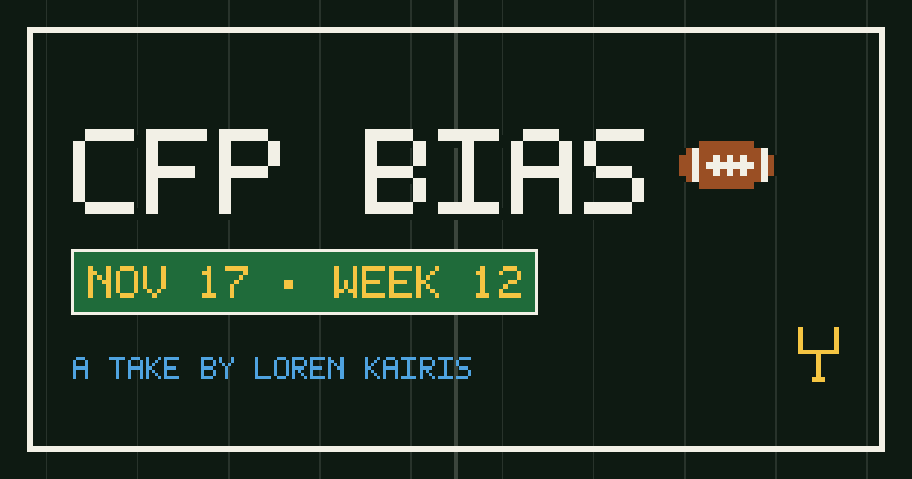

# Loren Kairis

Strategic accounts and AI commercial strategy. I started as a software engineer and have spent most of my career growing strategic accounts in analytics, advanced technology, and semiconductor markets, most recently at EnPro. I hold an MBA from the University of Georgia, an MSc in nanotechnology from TU Kaiserslautern, and a BS in mechanical engineering from Montana State. I live in Santa Fe, New Mexico.

## Focus

- **AI commercial strategy and implementation:** deciding which AI investments to make, turning pilots into deployed systems, and proving the business result.
- **Platforms and adoption:** what it takes for a complex technology to win customers and scale.
- **Machine learning:** hands-on since 2014, starting with neural networks in Wolfram.

## On GitHub

As a security practice, I keep most of my development work in private repositories. This profile holds public notes and selected projects.

- **[ai-commercial-notes](https://github.com/lorenkairis/ai-commercial-notes):** short weekly notes on AI commercial strategy and what company filings show about adoption.

## Side project: CFP Bias

[CFP Bias](https://cfpbias.com) sets my college football top 14 next to the College Football Playoff committee's rankings each week. Fans can rank their own 14, share a card, and see the combined crowd picks. The retro arcade design keeps it fast to use on a phone.

The source is in a private repository for the 2026 season and will move here once the season ends.

## Writing and projects

- [RevenueBrief](https://revenuebrief.com): a newsletter on how technology companies build markets, win customers, and grow
- [kairis.org](https://kairis.org): personal notes, books, and projects
- [Aumly](https://aumly.com): an app for planning a complete day

## Elsewhere

[lorenkairis.com](https://lorenkairis.com) · [LinkedIn](https://www.linkedin.com/in/kairis) · [Substack](https://lorenkairis.substack.com) · [Medium](https://medium.com/@lorenkairis) · [YouTube](https://www.youtube.com/@lorenkairis) · [X](https://x.com/lorenkairis) · [Crunchbase](https://www.crunchbase.com/person/loren-kairis)
